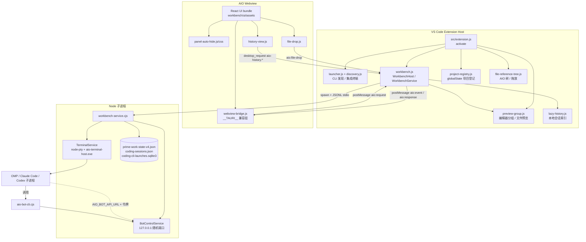
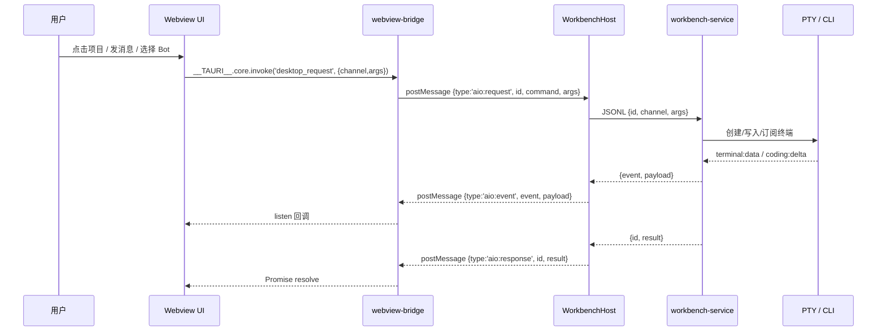

# AIO · AI CLI 工作台 — 功能分析报告（OMP 只读审计）

| 项 | 值 |
| --- | --- |
| 分析对象 | `D:\Github\Ancoder\AIO_IDE_Plugin`（VS Code 扩展） |
| 扩展版本 | `0.1.35`（`package.json:5`） |
| 当前 HEAD | `1cbe4de Render the workbench before service and project initialization` |
| 上游基线 | AIO `2.0.2`，commit `561bc25d4aeeec8310ab279e52e997b0f3ad1988`（`workbench/manifest.json:2-7`） |
| 验证 | 本次实际执行 `npm test`：**58 tests / 58 pass / 0 fail**，11.73 s（2026-11-27） |
| 约束 | 只读分析；除本文件外未修改/新建/删除仓库文件 |

---

## 1. 项目定位与目标用户

AIO IDE Plugin 把**本机已安装的 AI 编程 CLI**（OMP、Claude Code、Codex）接进 VS Code，提供两种使用形态：

1. **轻量启动器**：在 VS Code 集成终端里，以项目目录为 cwd 启动所选 CLI（`src/launcher.js:88-117`）。这是资源管理器 AIO 分组、活动栏 AIO 视图和命令面板的默认入口（`src/extension.js:20-31`）。
2. **完整工作台**：一个 React Webview + 独立 Node 后台服务，提供项目库、项目会话、模型目录、Claude/Codex 流式对话、三种智能体的后台任务、内嵌 PTY 终端、基础 Git 操作，以及 **AIO Bot** 多终端编排（`README.md:59`；`src/workbench.js:440-509`）。

目标用户与前提：

- **Windows x64 优先**：工作台内嵌终端按 Windows x64 打包（`README.md:61`；`workbench/manifest.json:16-26`）。
- 已自行安装并登录 OMP / Claude Code / Codex；扩展不负责安装、登录或主动发送模型请求（`DEVELOPMENT_PLAN.md:15`；`src/launcher.js:88-94`）。
- **受信任工作区**：未受信任时拒绝启动本机 CLI（`src/launcher.js:72-76`），扩展也声明不支持未受信任与虚拟工作区（`package.json:15-18`）。
- Remote 场景要求 CLI 与项目位于运行扩展的远程主机（`README.md:17`；`package.json:12` 的 `extensionKind: ["workspace"]`）。

产品边界（README 明确列为未迁移）：浏览器操作、定时长任务、技能执行、桌面更新器仍属于上游 Tauri 的迁移范围（`README.md:61`）。

---

## 2. 核心功能清单（按用户可见功能分组）

### 2.1 本机 CLI 启动器

| 用户可见功能 | 入口 / 命令 | 关键实现与证据 |
| --- | --- | --- |
| 选择 AI CLI 并打开终端 | 命令面板 `AIO: 选择 AI CLI 并打开终端`（`aio.openTerminal`） | Quick Pick 列出三者及检测结果（`src/launcher.js:119-126`）；无可用项时选择 `undefined` 直接返回 |
| 直接打开 OMP / Claude Code / Codex 终端 | `aio.openOmp` / `aio.openClaude` / `aio.openCodex` | `src/launcher.js:152-154`；终端名 `AIO · <label>`（`src/launcher.js:103-108`） |
| 活动栏 / 资源管理器入口 | `viewsContainers.aio` + `aio.sidebarLaunchers` / `aio.launchers` | `package.json:64-70`；树节点由 `src/extension.js:20-31` 生成，仅含 OMP、Claude Code、Codex、完整工作台 |
| 目录右键启动 | `explorer/context` 的 `aio.openTerminal`、`aio.openWorkbench` 等 | `package.json:57-62`；仅在 `explorerResourceIsFolder && isWorkspaceTrusted` 时显示 |
| 检测本机 CLI | `AIO: 检测本机 CLI`（`aio.detectClis`） | 三路并行探测并汇总路径（`src/discovery.js:105-107`；`src/launcher.js:130-136`） |
| 手动指定可执行文件 | 设置 `aio.ompPath` / `aio.claudePath` / `aio.codexPath` | `package.json:71-77`；machine scope；支持 `~` 与 `%VAR%` 展开（`src/discovery.js:13-21`） |
| 自动发现 PATH 之外的安装 | 无独立 UI | 除 PATH 外补充 `%APPDATA%\npm`、WinGet Links、`~/.local/bin`（`src/discovery.js:23-43`）；Windows 按 `PATHEXT` 展开（`src/discovery.js:45-52`） |
| 工作目录选择 | 打开终端时自动推断 | 传入 URI → 当前编辑器所属工作区 → 单根目录；多根弹 Quick Pick；空窗口弹目录选择（`src/launcher.js:17-42`） |
| 多终端并存 | 每次点击创建独立终端 | `vscode.window.createTerminal`（`src/launcher.js:103-108`）；`cliTerminals` 弱集合标记扩展创建的终端（`src/launcher.js:6,109`） |
| 终端选区复制 / 粘贴 | 终端标题栏按钮、命令面板 | `aio.copyTerminalSelection` / `aio.pasteIntoTerminal`（`package.json:32-33,42-45`）；仅对 AIO 终端启用（`src/launcher.js:156-166`） |
| 未安装 CLI 的提示 | 警告消息 + “打开设置” | `src/launcher.js:78-86` |

补充行为：

- `.cmd` / `.bat` 通过 `cmd.exe /d /v:off /s /c` 与环境变量传参，避免路径/参数被二次解析（`src/launcher.js:44-63`）；`.ps1` 用 `powershell.exe -NoLogo -NoProfile -File`（`src/launcher.js:64-71`）。
- OMP 终端注入 `COLORFGBG` 以匹配 VS Code 明暗主题（`src/launcher.js:66-70,102`）。
- 打开后主动聚焦终端输入（非 editor 区域时）（`src/launcher.js:111-115`）。

### 2.2 完整工作台（AIO 2.x Webview）

| 用户可见功能 | 入口 | 关键实现与证据 |
| --- | --- | --- |
| 打开工作台 | `AIO: 打开完整工作台`、目录右键、活动栏“完整工作台” | `aio.openWorkbench`（`package.json:39,61`；`src/workbench.js:721-728`） |
| 启动时自动打开 | 受信任窗口激活后 | `src/extension.js:32-35`：无待恢复 handoff 且工作区受信任时 `workbenchHost.open()` |
| 独立编辑器分组 + 锁定 | 自动 | 新建右侧分组并 `lockEditorGroup`，避免 Explorer 打开文件覆盖 AIO（`src/workbench.js:417-438`） |
| 项目库 / 添加项目 | 工作台“项目”页、拖拽、Explorer 右键 | 服务端 `projects:add-selected`（`src/workbench.js:659-673`）；项目列表合并 `projects:list-initial`（`src/workbench.js:611-614`） |
| 点击项目切换窗口 | 左侧项目名 | 校验已登记项目 → 写 60 s handoff → `vscode.openFolder` 重载窗口（`src/workbench.js:372-402`；`src/project-handoff.js:5,43-77`） |
| 项目历史会话 | 左栏项目分组内 OMP / Claude / Codex 三组 | `history-view.js` 注入 DOM（`src/history-view.js:3-6,16-58,63-78`）；按 provider 懒加载并缓存（`src/workbench.js:615-647`） |
| 会话 / 模型 / 流式对话 | 工作台会话页、底部 composer | 服务 `coding:send` 仅允许 Claude/Codex（`workbench/service/workbench-service.cjs:31108-31110`）；OMP 走 `headless:*`（同文件 `31111-31114`） |
| 内嵌终端抽屉 | 项目终端 | 服务 `terminal:*` 通道（`workbench/service/workbench-service.cjs:31210-31305`）；PTY 由 `node-pty` / `aio-terminal-host.exe` 支撑（同文件 `1947,2018,30844-30849`） |
| 工作台终端复制 / 粘贴 | Webview 右键菜单 `复制` / `粘贴` | `aio.copyWorkbenchTerminalSelection` / `aio.pasteIntoWorkbenchTerminal`（`package.json:34-35,46-49`）；桥接层注册 xterm 实例（`src/webview-bridge.js:118-139,186-199`） |
| Bot 选择器 | 底部选择无 Bot / OMP / Claude Code / Codex | 生成 UI 含 `bot-selector` 与 `OMP Bot`、`Claude Code Bot`、`Codex Bot`（`test/bridge.test.js:31-33`）；行为见 README `25-29` |
| 侧栏自动显隐 | 打开 4 s 后侧栏收起，悬停/点击恢复 | `src/panel-auto-hide.js:280-292`；受保护区域（composer、终端等）不触发边缘展开（同文件 `8-13,306`） |
| 文件预览并排 + 自动收起 | 工作台上缘“文件预览”按钮 | `src/preview-group.js:8-9,107-160,189-220`；Windows 用 PowerShell 观察鼠标是否在预览区（同文件 `30-68`） |
| 子页面返回 | 页面右上角 `×` | 构建时注入 `onClosePage` / 页面栈（`scripts/build-workbench.cjs:98-160`） |
| 默认深色主题 | 自动 | 构建时改写 UI 与服务默认 `theme:"dark"`（`scripts/build-workbench.cjs:809-824`；`README.md:33`） |
| 基础 Git / 模型目录 / 活动记录 | 工作台对应页面 | 由随包服务实现并透传（`src/workbench.js:676-684`；`README.md:59`） |

### 2.3 文件 / 文件夹引用与项目导入

| 功能 | 入口 | 证据 |
| --- | --- | --- |
| Explorer 拖拽到 AIO 树节点引用路径 | 资源管理器 `AIO → 拖到此处引用到工作台` | 树节点仅在工作台打开时出现（`src/file-reference-tree.js:47-51`）；drop 控制器（同文件 `66-88`） |
| 右键引用选中项 | `AIO: 在 AIO 对话中引用路径` | `src/file-reference-tree.js:89-104`；通过 `resourceCandidates` 读取 URI（同文件 `17-38`） |
| 拖拽到工作台输入区 | Webview 原生 drop | 目标为 composer textarea、xterm、项目侧栏（`src/file-drop.js:35-48`）；最多 16 项（同文件 `8-13`） |
| 拖入文件夹添加项目 | Explorer `AIO → 拖入文件夹以添加项目` / 右键 `在 AIO 中添加项目` | `src/file-reference-tree.js:39-45,105-117`；`src/workbench.js:338-357` |
| 引用不会自动发送、不读正文 | 设计约束 | 只把路径文本插入最近可见的 composer/终端（`src/file-drop.js:63-85`）；README `45-47` |

### 2.4 Bot 编排（用户可见）

| 功能 | 入口 | 证据 |
| --- | --- | --- |
| 选择 Bot 并打开 `_Bot` 终端 | 底部 Bot 选择器 | `README.md:25`；服务端 `role === "bot"` 时 `prepare` 会话并给标签加 `_Bot`（`workbench/service/workbench-service.cjs:31261-31271`） |
| 底部输入路由到所选 Bot | 底部对话输入 | 生成 UI 以 `terminalTarget` 绑定所选 Bot 终端（`workbench/ui/assets/main-*.js` 的 `bot-selector` / `terminalTarget`；`test/bridge.test.js:31-33`） |
| Bot 创建 / 发送 / 关闭工作终端 | 随包 `aio-bot-cli.cjs` | `workbench/service/aio-bot-cli.cjs:26-44,110-153`；服务端 HTTP 控制（`workbench/service/workbench-service.cjs:30723-30800`） |
| 工作终端上报进度/完成 | `aio-bot report <status> <summary>` | `aio-bot-cli.cjs:128-131,155-168`；服务端仅允许 worker token `POST /v1/events`（`workbench-service.cjs:30729-30731`） |
| 关闭 Bot 级联关闭工作终端 | 选择“无 Bot”或 Bot 终端退出 | `onTerminalExit` 遍历 `session.workers` 并 kill（`workbench-service.cjs:30657-30679`） |
| Codex 工作终端接收多行后续任务 | Bot `send` | 外部编辑器回填协议（`workbench-service.cjs:2149-2210`；`aio-codex-editor.cjs:56-110`） |
| 新 Codex 终端直接接收多行首任务 | `create codex --stdin` | `aio-bot-cli.cjs:155-180`；服务端将 `initialPrompt` 作为 `-- <prompt>` 追加（`workbench-service.cjs:31250-31259`） |

### 2.5 安装与分发

- VSIX：`dist/aio-ide.vsix`（已存在，约 2.16 MB）；`npm run package` 使用 `vsce package --no-dependencies`（`package.json:23`）。
- 安装：`code --install-extension dist/aio-ide.vsix`（`README.md:21`）。
- 打包前检查：`prepackage` 校验 manifest 声明的生成物与 Windows 下 `node-pty` prebuild（`scripts/check-workbench.cjs:1-20`）。
- `.vscodeignore` 排除测试、脚本、文档、dist、install.cmd（`.vscodeignore:1-18`）。

---

## 3. 架构与关键模块



### 3.1 扩展宿主模块

| 文件 | 职责 | 关键交互 |
| --- | --- | --- |
| `src/extension.js` | 激活入口；注册启动器、项目登记、工作台、AIO 树；启动时打开工作台 | `activate()` 顺序：`registerLauncher` → `ProjectRegistry.start` → `registerWorkbench` → `registerFileReferenceTree` → `resumeProjectHandoff` / `open`（`src/extension.js:11-36`） |
| `src/launcher.js` | 解析 cwd、信任检查、CLI 发现、创建 VS Code 集成终端、剪贴板命令 | 调用 `discoverCli`（`src/launcher.js:90-95`）；`terminalLaunch` 处理 Windows shim（同文件 `44-71`）；`openCli` 是唯一终端创建点（同文件 `88-117`） |
| `src/discovery.js` | CLI 定义、配置路径展开、PATH/注册目录探测 | 三 provider 固定表（`src/discovery.js:7-11`）；配置为绝对路径时不再搜索 PATH（同文件 `86-103`） |
| `src/workbench.js` | 工作台面板、宿主与服务生命周期、Webview 消息路由、CSP、项目切换、剪贴板与引用请求 | `WorkbenchHost`（`src/workbench.js:232`）持有单面板与单服务；`WorkbenchService`（同文件 `83-199`）通过 stdio JSONL 与子进程通信 |
| `src/project-registry.js` | 把 VS Code 工作区根目录登记到 `globalState`，并与工作台项目库双向同步；记录 removed 墓碑 | 条目 key 为 `aio.projectRegistry.v1.<sha256>`（`src/project-registry.js:8,19-21`）；`syncService` 合并历史项目（同文件 `137-183`）；`start` 监听工作区变化（同文件 `189-198`） |
| `src/project-handoff.js` | 跨窗口项目切换的短期交接 | 60 s TTL（`src/project-handoff.js:5-6`）；目标目录为 key（同文件 `43-54`）；恢复时先删除目标条目，防止递归（同文件 `56-77`） |
| `src/preview-group.js` | 管理 AIO 与文件编辑器的两组布局、自动收起/展开、Windows 鼠标位置观察 | `captureBaseline` / `attach` / `expand` / `collapse`（`src/preview-group.js:99-232`）；依赖 `vscode.getEditorLayout` 与 `toggleMaximizeEditorGroup` |
| `src/file-reference-tree.js` | AIO 树视图 + 两个 drop target；仅工作台打开时显示 | `getChildren` 动态加入 `projectTarget` / `dropTarget`（`src/file-reference-tree.js:47-51`）；注册 `aio.referenceInWorkbench` / `aio.importProjectInWorkbench`（同文件 `89-118`） |
| `src/lazy-history.js` | 只读扫描 OMP/Claude JSONL、Codex SQLite，生成会话目录与 resume 参数 | 目录编码规则（`src/lazy-history.js:104-141`）；Codex 取最新 `state_N.sqlite`（同文件 `88-101`）；`resumeArgs`（同文件 `144-148`） |

### 3.2 Webview 模块

| 文件 | 职责 | 关键交互 |
| --- | --- | --- |
| `workbench/ui/*` | 上游 AIO 2.0.2 React 构建产物 | `index.html` 仅一个模块脚本（`workbench/ui/index.html:8`）；资源分块 `main`、`index`、`TerminalDrawer`、`markdown-vendor` 等 |
| `src/webview-bridge.js` | 把 Tauri `invoke/listen` 适配到 VS Code `postMessage`；终端键盘/剪贴板/拖放/预览事件 | 定义 `window.__TAURI__`（`src/webview-bridge.js:253-260`）；请求关联（同文件 `160-173`）；xterm 注册（同文件 `118-139`）；Ctrl+C/V 与右键粘贴（同文件 `54-81`） |
| `src/panel-auto-hide.js` | 运行时改造上游 DOM：注入左栏/检查器 toggle、4 s 首屏、悬停展开、文件预览入口 | `installAutoHidePanels`（`src/panel-auto-hide.js:17-...`）；`ensureToolbarToggles` 按 CSS 类和图标 path 识别按钮（同文件 `228-250`）；4 s 计时（同文件 `286-296`） |
| `src/file-drop.js` | 解析拖拽 MIME、定位 composer/xterm/侧栏、插入路径文本；校验 Webview drop 消息 | `extractDropCandidates`（`src/file-drop.js:35-48`）；`insertReferences` 使用原生 setter + `InputEvent` 兼容 React（同文件 `63-85`）；`validFileDropRequest`（同文件 `88-...`） |
| `src/history-view.js` | 向工作台左栏注入三 provider 历史按钮；缓存优先、点击加载、点击恢复 | 依赖 `.sidebar .project-group` 与 `button.project-row__main` 的 `title` 作为项目路径（`src/history-view.js:63-72`）；调用 `aio-history:cached/list/resume`（同文件 `6,26-58`） |

### 3.3 后台服务

`workbench/service/workbench-service.cjs`（约 31.7k 行，esbuild 打包自上游 `research/tauri-spike/workbench-service.ts`）：

- **协议**：stdin/stdout 每行一个 JSON；请求 `{id, channel, args}`，响应 `{id, result|error}`，事件 `{event, payload}`。宿主限制请求 2 MiB、响应 32 MiB、单请求 90 s（`src/workbench.js:19-22,144-173`；服务端线路上限 2 MiB，`workbench-service.cjs:30861` 附近）。
- **通道域**：`projects:*`、`terminal:*`、`coding:*`、`headless:*`、`coding-plugins:*`、`app:*`、`sessions:*`、`providers:*`、`aio-history:*`（由宿主转发）。服务 `dispatch` 以 switch 实现（`workbench-service.cjs:31070-31330`）。
- **持久化**：工作台 profile 位于 `context.storageUri/workbench`（`src/workbench.js:456`）；服务状态文件 `prime-work-state-v4.json`（`workbench-service.cjs:26250-26251`）、`coding-sessions.json`（同文件 `31339,31413`）、`coding-cli-launches.sqlite3`（同文件 `31357`）、`coding-cli-plugins.json`（同文件 `31417`）、`terminal-sessions/`（同文件 `31407`）。
- **PTY**：`node-pty` + `aio-terminal-host.exe` 作为 Windows 终端宿主（`workbench-service.cjs:1947,2018,30844-30849`）。非 Windows 直接抛错。
- **CLI 插件注册表**：`coding-plugins:list/set/set-executable`，支持独立启用/禁用/卸载与自定义可执行文件（`workbench-service.cjs:27935-28000,31074-31090`）。禁用/卸载时把对应终端恢复项标记 `dormant`（同文件 `31080-31086`）。
- **Bot 控制**：见 §5.3。

### 3.4 关键交互时序



宿主 `handleMessage` 还处理非 `desktop_request` 的消息：文件预览 ready/show、项目激活、文件引用结果、终端选区结果、Webview drop（`src/workbench.js:511-600`）。所有请求先经过 `validWebviewRequest` 的 id/command/大小校验（同文件 `226-230`）。

---

## 4. 技术栈、运行时依赖、打包方式

| 层 | 技术 / 依赖 | 证据 |
| --- | --- | --- |
| 扩展宿主 | Node.js CommonJS，`engines.vscode ^1.97.0`，`main: ./src/extension.js`，`activationEvents: onStartupFinished` | `package.json:10-14` |
| 扩展运行时依赖 | **无 `dependencies` 字段**；仅用 VS Code API 与 Node 内置模块 | `package.json:1-80`；各 `src/*.js` 仅 `require('vscode')` / `node:*` |
| Webview | React + Vite 构建的 AIO 2.0.2 UI；xterm 6；markdown/lucide 分块 | `workbench/ui/index.html:8`；`workbench/manifest.json:28-40` |
| Webview 安全 | CSP `default-src 'none'`、nonce 脚本、`connect-src 'none'`、`enableCommandUris:false`、受限 `localResourceRoots` | `src/workbench.js:205-224,424-429` |
| 后台服务运行时 | 外部 `node` ≥ **22.13**（需 `node:sqlite`）；若 VS Code 自带 Node 不满足则扫 PATH | `src/workbench.js:24,46-80`；`README.md:61` |
| 服务构建目标 | esbuild `platform:node`、`target:node24`、`format:cjs`、`external:node-pty` | `scripts/build-workbench.cjs:371-420` |
| 内嵌终端 | `node-pty` prebuild（win32-x64）+ Rust `aio-terminal-host.exe`（windows-sys） | `scripts/build-workbench.cjs:689-716`；`workbench/manifest.json:16-26` |
| 状态存储 | VS Code `storageUri/workbench`；JSON 状态 + `node:sqlite` 台账 | `src/workbench.js:456`；`workbench-service.cjs:26250-26251,31357` |
| 打包 | `vsce package --no-dependencies --out dist/aio-ide.vsix`；`prepackage` 校验资产 | `package.json:22-23`；`scripts/check-workbench.cjs:1-20` |
| 构建前置 | `AIO_SOURCE` 指向装有开发依赖的 AIO checkout；Windows 需 Rust/Cargo + MSVC | `README.md:63`；`scripts/build-workbench.cjs:16-18,689-699` |
| 上游固定 | UI/服务按 commit `561bc25…` 生成，并在构建时校验上游特征字符串 | `workbench/manifest.json:2-15`；`scripts/build-workbench.cjs:43-55` |

平台约束汇总：

- 内嵌 PTY：仅 `win32`（`workbench-service.cjs:30844-30847`）。
- 扩展本身可作为 workspace 扩展运行在远程，但 CLI 必须在远程主机（`README.md:17`）。
- 不支持 untrusted / virtual workspace（`package.json:15-18`）。
- 构建产物 `nodeTarget: 24`，但宿主探测门槛是 22.13（`workbench/manifest.json:16`；`src/workbench.js:24`）。

---

## 5. 与 OMP / Claude Code / Codex 的集成方式

### 5.1 发现与启动参数

三者在扩展与服务中各有一套发现逻辑，但都落到同一组命令名：

| Agent | 默认命令 | 扩展启动参数 | 工作台/Bot 额外注入 |
| --- | --- | --- | --- |
| OMP | `omp` | `--config <extension>/workbench/service/aio-omp-config.yml`；`COLORFGBG` 主题环境 | `--append-system-prompt=<prompt>`（Bot/worker）；恢复时 `--session-dir <dir>` + `--continue` |
| Claude Code | `claude` | 无额外参数 | `--append-system-prompt <prompt>`；`--continue`；`--resume <uuid>` |
| Codex | `codex` | `-c disable_paste_burst=true` | `-c developer_instructions=<json>`；`--model <id>`；`resume <id>`；`-- <initialPrompt>` |

证据：

- 扩展入口参数拼接：`src/launcher.js:99-102`。
- OMP 配置内容仅关闭 composer 预测：`workbench/service/aio-omp-config.yml:1-2`；构建脚本也会把该配置注入服务启动参数（`scripts/build-workbench.cjs:673-687`）。
- Bot/worker 系统提示注入映射：`workbench-service.cjs:30582-30586`。
- OMP 恢复会话：`--session-dir` 与 `--continue`（`workbench-service.cjs:31243-31260` 及构建补丁 `scripts/build-workbench.cjs:673-687`）。
- Claude 恢复：`--continue` / `--resume`（`src/lazy-history.js:144-148`；`src/workbench.js:644-646`）。
- Codex：`resume <id>`、`--model`、`--` 首任务、外部编辑器（`workbench-service.cjs:31250-31259,2149-2210`）。

Windows shim 处理：

- 扩展侧：`.cmd/.bat` 用 `cmd.exe` 包装并把可执行文件与参数放进环境变量（`src/launcher.js:44-63`）；`.ps1` 交给 PowerShell（同文件 `64-71`）。
- 工作台侧：同样打包 `aio-terminal-host.exe`/node-pty，由服务 `resolveTerminalAgent` 解析可执行文件（`workbench-service.cjs:30928-30960`）。

### 5.2 上下文注入方式

**没有“自动读取编辑器内容并塞进 prompt”的机制。** 上下文来源只有四类：

1. **cwd**：CLI 在选中项目目录启动，CLI 自行读取项目（`src/launcher.js:17-42,103-108`）。
2. **显式路径引用**：Explorer 拖拽/右键只把路径文本插入当前 composer 或终端输入区，不自动发送、不读文件正文（`src/file-drop.js:63-85`；`README.md:45-47`）。
3. **系统提示 / 技能**：Bot 与 worker 终端分别追加 `BOT_SYSTEM_PROMPT` / `BOT_WORKER_SYSTEM_PROMPT`（`workbench-service.cjs:30857-30858,31255-31268`）。Bot 提示内嵌“AIO Bot”技能文本（构建时从上游 `assets/omp-skills/skills/aio-bot/SKILL.md` 读取并打包，`scripts/build-workbench.cjs:371-420`）。
4. **历史会话恢复**：通过 CLI 原生 `--resume` / `--continue` / `resume` 接续原会话（`src/workbench.js:644-646`；`src/lazy-history.js:144-148`）。

### 5.3 Bot 控制协议

**拓扑**：`BotControlService` 在服务进程内监听 `127.0.0.1:0`（随机端口），把 `AIO_BOT_API_URL` 注入 Bot 与 worker 环境（`workbench-service.cjs:30693-30713,30767`）。

**会话与令牌**：

- 每次创建 `role:"bot"` 终端时生成 session：`id` + 32 字节 hex token（`workbench-service.cjs:30639-30643`）。
- Bot 终端环境额外含 `AIO_BOT_SESSION_ID`、`AIO_BOT_CAPABILITY`、`AIO_BOT_API_URL`、`AIO_BOT_CLI`、`AIO_BOT_NODE`（`workbench-service.cjs:30642,31264-31265`）。
- worker 终端使用**独立 worker token**；该 token 只能 `POST /v1/events`，不能创建/控制终端（`workbench-service.cjs:30749-30767,30729-30731`）。

**HTTP 路由**：

| 方法 | 路径 | 作用 | 证据 |
| --- | --- | --- | --- |
| GET | `/v1/terminals` | 列出当前 Bot 拥有的工作终端 | `workbench-service.cjs:30732-30734` |
| POST | `/v1/terminals` | 创建工作终端（`agent`、`model`、Codex `initialPrompt`） | 同文件 `30749-30788` |
| POST | `/v1/terminals/:id/input` | 发送任务/输入，最多 64 KiB | 同文件 `30790-30796` |
| DELETE | `/v1/terminals/:id` | 关闭工作终端 | 同文件 `30797-30803` |
| GET | `/v1/events?waitMs=N` | 拉取事件，`waitMs` 上限 25 s | 同文件 `30735-30748` |
| POST | `/v1/events` | worker 上报事件 | 同文件 `30794-30800` |

**强制边界**：

- 无 Bearer token → 401；worker token 访问非 `/v1/events` → 403；终端不属于该 session → 404（`workbench-service.cjs:30723-30745,30790`）。
- 请求体有大小上限（`MAX_BODY_BYTES`，`workbench-service.cjs:30592-30605`）。
- 事件队列上限 256，超出丢弃最旧事件（同文件 `30838-30844`）。
- 终端退出：worker 退出 → 记 `terminal_exit` 事件；Bot 终端退出 → 关闭 session 并 kill 所有 worker（同文件 `30657-30679`）。

**CLI → HTTP 映射**（`workbench/service/aio-bot-cli.cjs:110-153`）：

| 命令 | HTTP |
| --- | --- |
| `list` | `GET /v1/terminals` |
| `create <omp|claude|codex> [--model] [--stdin]` | `POST /v1/terminals` |
| `send <id> <prompt>|--stdin` | `POST /v1/terminals/<id>/input` |
| `close <id>` | `DELETE /v1/terminals/<id>` |
| `events [--wait ms]` | `GET /v1/events?waitMs=` |
| `report <status> <summary>` | `POST /v1/events` |

`--stdin` 最多 64 KiB；`create --stdin` 仅 Codex 可用；`report` 的 status 最多 64 字符（`aio-bot-cli.cjs:46-108,155-180`）。

**Codex 多行后续任务协议**（Windows）：

1. 服务为每个 Codex 终端设置独立 spool 目录与 `VISUAL`/`EDITOR` 指向 `aio-codex-editor.cjs`（`workbench-service.cjs:2149-2155`；构建补丁 `scripts/build-workbench.cjs:423-530`）。
2. `send` 写入 `request.json`（`{v, nonce, text, bytes, sha256}`），并向终端写 `\x07` 打开外部编辑器（`workbench-service.cjs:2157-2170`）。
3. 助手读取草稿、校验 nonce/字节数/SHA-256、原子写入 `ack.json`；若已有手工草稿则返回 `draft-not-empty`（`aio-codex-editor.cjs:56-110`）。
4. 服务等待 `editorReady`、bracketed paste 状态与输出代数变化，再依次写 `ESC`、`Home`、`Enter`，只提交一次（`workbench-service.cjs:2172-2210`）。
5. 8 秒 deadline；失败抛出明确错误（同文件 `2130-2145,2192-2205`）。

### 5.4 OMP 专项

- 扩展启动 OMP 固定传 `--config aio-omp-config.yml`，仅关闭 composer 预测（`src/launcher.js:99-102`；`aio-omp-config.yml:1-2`）。
- 工作台恢复 OMP 会话时使用 `--session-dir` + `--continue`，并用构建补丁把配置路径注入（`scripts/build-workbench.cjs:673-687`）。
- OMP 模型目录/元数据由 `omp-metadata-worker.cjs` 工作线程与 `prime-agent-ai` 模型表提供（`workbench-service.cjs:28423`；`workbench/manifest.json:19-27`）。
- Bot/worker 对 OMP 使用 `--append-system-prompt=<prompt>`（`workbench-service.cjs:30582-30586`）。
- OMP 历史会话除标准 sessions 目录外，还会扫描工作台 `terminal-sessions/<uuid>` 恢复桶（`src/workbench.js:629-639`）。

---

## 6. 构建、测试与验证

### 6.1 常用命令

| 目的 | 命令 | 说明 / 证据 |
| --- | --- | --- |
| 单元/集成测试 | `npm test` | `node --test test/*.test.js`（`package.json:20`） |
| 重建工作台资源 | `npm run build:workbench` | 需 `AIO_SOURCE`、上游依赖；Windows 还需 Rust/Cargo/MSVC（`README.md:63`） |
| 仅重建 UI | `node scripts/build-workbench.cjs --ui-only` | `scripts/build-workbench.cjs:835-850` |
| 仅重建 Bot 服务 | `node scripts/build-workbench.cjs --bot-service-only` | 同文件 `843-849` |
| 校验上游特征 | `node scripts/build-workbench.cjs --verify-synced-upstream` | 同文件 `43-55,838` |
| 校验打包资产 | `npm run prepackage` | `scripts/check-workbench.cjs:1-20` |
| 生成 VSIX | `npm run package` | 需 `@vscode/vsce`（`package.json:23`；`README.md:21`） |
| Extension Host 冒烟 | `node test-host/run-smoke.cjs` | 需 `VSCODE_EXECUTABLE_PATH`；`--installed` 启动本机三 CLI（`test-host/README.md:1-30`） |
| 真实 Webview 验收 | `node test-host-ui/verify-workbench.cjs dist/aio-ide.vsix` | 需 `VSCODE_EXECUTABLE_PATH`，并从 `AIO_SOURCE` 的 `package.json` 解析 Playwright（`test-host-ui/verify-workbench.cjs:59-63`） |
| Bot UI 验收 | `AIO_TEST_BOT_UI=1 node test-host-ui/verify-workbench.cjs dist/aio-ide.vsix` | `docs/BOT_DEVELOPMENT_PLAN.md:13-16` |
| 真实 Codex 提交验收 | 设 `AIO_TEST_CODEX_SUBMISSION_EXE` 后同上 | 同上 |

### 6.2 本次实测

```
npm test
ℹ tests 58
ℹ pass 58
ℹ fail 0
ℹ duration_ms 11730.06
```

覆盖范围（测试文件）：

- 启动器/发现：`test/launcher.test.js`
- 工作台桥/CSP/消息：`test/bridge.test.js`（432 行）
- 工作台服务与 PTY：`test/workbench-terminal.test.js`（Windows x64 才运行）
- Bot 打包内容与 CLI 传输：`test/bot-runtime.test.js`
- 项目登记/切换：`test/project-registry.test.js`、`test/project-handoff.test.js`
- 文件拖放/引用：`test/file-drop.test.js`、`test/file-reference-tree.test.js`
- 面板/预览/主题/启动：`test/panel-auto-hide.test.js`、`test/preview-group.test.js`、`test/default-theme.test.js`、`test/startup-panel.test.js`
- 历史：`test/lazy-history.test.js`
- 上游同步/预测开关：`test/upstream-sync.test.js`、`test/omp-predictions.test.js`

**未在 `npm test` 中执行的部分**：

- `test-host/` 与 `test-host-ui/` 需真实 VS Code / Electron / Playwright，共 20 个 UI 验证脚本，其中 `verify-workbench.cjs` 是总入口。
- 真实账号下的模型请求、Git 写操作、Codex 新版本兼容性未由本次只读分析复验；仓库文档也把“真实账号与 Git 写操作”列为未逐项验收（`DEVELOPMENT_PLAN.md:27`）。
- 未发现 `.github/` 或其他 CI 配置；测试与打包均依赖本机命令。

### 6.3 构建时的“上游补丁”流程

`build-workbench.cjs` 不是简单拷贝，而是：

1. 用 Vite 从 `AIO_SOURCE` 构建 React UI（`scripts/build-workbench.cjs:98-283`）。
2. 在 Vite 插件里对上游 `App.tsx`、`TitleToolbar.tsx`、`TerminalDrawer.tsx` 做**字符串锚点替换**，注入 VS Code 需要的键盘路由、子页返回、终端注册、主题对比度（同文件 `98-283`）。
3. 构建后再对生成的压缩 chunk 做二次字符串替换（`patchGeneratedTerminalClipboard`，同文件 `285-369`）。
4. 用 esbuild 打包服务，并对 `workbench-service.ts`、`electron/main/terminal.ts` 做锚点补丁，注入 Bot 控制、Codex 外部编辑器、bracketed paste 追踪（同文件 `371-672`）。
5. 构建 Rust `aio-terminal-host.exe`、复制 node-pty prebuild、生成许可证清单与 manifest（同文件 `689-833`）。

---

## 7. 风险、局限与待完善点（按影响排序）

| # | 风险 / 局限 | 证据 | 影响 |
| --- | --- | --- | --- |
| 1 | **强耦合上游 AIO 版本与源码字符串锚点** | `scripts/build-workbench.cjs:43-55,98-283,285-369,371-672`；`workbench/manifest.json:2-7` | 上游任何组件重命名/文案变化都会让构建直接抛错；升级成本高，且补丁本身难以维护 |
| 2 | **内嵌终端仅 Windows x64** | `workbench-service.cjs:30844-30849`；`workbench/manifest.json:16-26`；`README.md:61` | macOS/Linux 无法使用工作台终端抽屉、Bot 工作终端、Codex 多行提交；扩展只剩集成终端启动器 |
| 3 | **依赖外部 Node ≥22.13（`node:sqlite`）** | `src/workbench.js:24,46-80`；`README.md:61` | VS Code 自带 Node 版本不足时必须能找到 PATH 中的新 Node，否则工作台直接报错无法启动；Codex 历史索引也依赖该运行时（`src/lazy-history.js:155-167`） |
| 4 | **工作台宿主主动屏蔽部分会话/任务目录** | `src/workbench.js:607-610`（`sessions:list`、`coding:list`、`coding:list-summaries`、`terminal:list-restorable` 返回空）；`650`（`long-run:list-tasks` 返回 `[]`） | 上游 UI 的会话列表、后台任务列表在 VS Code 中不可见；历史改由注入式 `history-view.js` 提供，功能不对等 |
| 5 | **服务崩溃后无自动重启** | `src/workbench.js:470-473` 仅记录日志/弹错；`691-711` 关闭时销毁服务 | 子进程退出后工作台成为“死面板”，用户必须关闭再重开标签；长任务会丢 |
| 6 | **激活即自动打开工作台** | `src/extension.js:32-35` | 只用 CLI 启动器的用户也会承担 Webview + 后台服务启动成本；这与用户反馈的“启动慢”直接相关（`docs/user-input/2026-11-27.md` 第 4、8 条） |
| 7 | **UI 改造依赖 DOM/CSS/图标/文案** | `src/panel-auto-hide.js:8,228-250`（按 `.title-toolbar__actions`、SVG path 识别按钮）；`src/history-view.js:63-72`（按 `button.project-row__main` 的 `title` 取项目路径）；`src/preview-group.js:99-160`（依赖两组布局） | 上游 UI 改版、国际化或无障碍属性变化会让按钮注入、历史挂载、自动显隐、文件预览静默失效 |
| 8 | **Codex 自动化与 TUI 状态字符串/外部编辑器强绑定** | `workbench-service.cjs:30850-30854`（ready/busy 文案）；`2149-2210`（8 s deadline、bracketed paste 代数）；`scripts/build-workbench.cjs:371-420`（替换上游状态锚点） | Codex 版本升级改变提示文案、外部编辑器协议或 bracketed paste 行为时，多行后续任务会失败；已有明确错误但无降级路径（仅单行可发） |
| 9 | **Bot 令牌以环境变量形式存在于终端进程** | `workbench-service.cjs:30639-30643,30664-30667,31264-31265` | Bot 终端内任意子进程可读取 Bot token 并控制该 session 的 worker；worker token 仅能上报事件，降低了横向风险，但终端内运行不可信脚本仍可伪造进度/完成事件 |
| 10 | **项目登记身份只取第一个工作区根** | `src/project-registry.js:41-45`（`workspaceFolders[0]`） | 多根工作区中第二个根若来自不同 remote authority，不会被登记/同步；全局 `globalState` 条目只按首个 authority 过滤（同文件 `115-121`） |
| 11 | **项目切换依赖 60 s handoff 与窗口重载** | `src/workbench.js:389-397`；`src/project-handoff.js:5-6,56-77` | 目标目录很大/窗口恢复超过 60 s 时 handoff 过期，工作台不会自动重开；切换期间未保存编辑依赖 VS Code 原生提示 |
| 12 | **历史会话解析依赖 CLI 私有磁盘格式** | `src/lazy-history.js:88-148`（OMP/Claude 目录编码、JSONL 首行、Codex `state_N.sqlite` 的 `threads` 表） | CLI 升级改变目录/字段即失效；只支持这三家；恢复通过新开集成终端，而非工作台内嵌终端（`src/workbench.js:644-646`） |
| 13 | **`install.cmd` 是未引用的远程安装脚本** | `install.cmd:4-16` 下载并执行 `https://herdr.dev/install.ps1`；`.vscodeignore:18` 将其排除出 VSIX | 与扩展功能无关，来源/用途未在 README/package 中说明；若被用户误用属于供应链风险 |
| 14 | **文档版本漂移** | `README.md:59` 写 AIO 2.0.1；`workbench/manifest.json:3` 为 2.0.2；`DEVELOPMENT_PLAN.md:19` 写基线 commit `def7f85…`，manifest 为 `561bc25…` | 复现构建/验收时容易按错误版本操作 |
| 15 | **测试覆盖偏静态/单元，真实 UI 验收未纳入默认测试** | `package.json:20` 只跑 `test/*.test.js`；`test-host-ui/verify-workbench.cjs:59-63` 需要外部 VS Code + 上游 AIO + Playwright | 默认 CI/本地 `npm test` 不能发现 Webview 布局、剪贴板、真实 CLI 版本回归；本次 58 项全过不代表真实窗口全过 |
| 16 | **Webview CSP 允许 `style-src 'unsafe-inline'` 与 `img-src https:`** | `src/workbench.js:208-218` | 风险低于允许脚本内联，但仍扩大样式注入面；`connect-src 'none'` 阻止 Webview 直接联网，缓解了数据外带 |
| 17 | **右栏/左栏自动显隐、文件预览依赖 VS Code 命令与 Win32 鼠标观察** | `src/preview-group.js:30-68`（PowerShell + Win32 API）；`src/panel-auto-hide.js:286-296` | 非 Windows、VS Code 命令行为变化、或用户自定义布局时会退化为不收起/不展开；代码有 `abandon` 但用户可见反馈有限 |
| 18 | **无请求级并发/背压控制** | `src/workbench.js:144-173`（逐条写 stdin，未等待 drain）；`19-22` 仅单帧大小与超时 | 大量并发请求或服务变慢时，stdin 缓冲可能增长；当前 UI 请求量有限，风险中低 |

### 7.1 已确认可工作的部分（降低误判）

- 58 项自动测试全部通过，包括 Windows PTY 三 provider 的创建/输入/关闭（`test/workbench-terminal.test.js:13-60`）与 Bot 打包内容/CLI 精确传输（`test/bot-runtime.test.js:14-129`）。
- 启动面板先渲染后初始化服务，项目同步阻塞不会阻止插件列表请求（`test/startup-panel.test.js:32-132`）。
- 项目登记 tombstone、远程 authority 隔离、handoff 单次恢复均有测试（`test/project-registry.test.js`、`test/project-handoff.test.js`）。

### 7.2 本次未验证（只读分析边界）

- 未在真实 VS Code 窗口安装 VSIX 复跑 20 个 `test-host-ui` 脚本。
- 未连接真实 OMP/Claude/Codex 账号发送模型请求。
- 未验证 Codex 新版本（>0.172.0）的 TUI 文案与外部编辑器行为。
- 未验证 macOS/Linux（代码明确不支持工作台终端）。
- 未测量冷启动耗时与内存；仅确认 `extension.js:32-35` 会在激活时创建工作台。

---

## 8. 可复核结论摘要（10 条以内）

1. **这是“启动器 + Webview 工作台 + 独立 Node 服务”三层扩展，而非纯终端插件。** 启动器在 `src/launcher.js:88-117`，工作台宿主在 `src/workbench.js:232-719`，服务由 `WorkbenchService.start` 以 stdio JSONL 拉起（`src/workbench.js:95-123`）。
2. **三个 CLI 的启动参数是硬编码且可复核的**：OMP 加 `--config aio-omp-config.yml` 与主题环境，Codex 加 `-c disable_paste_burst=true`，Claude 无额外参数（`src/launcher.js:99-102`）。
3. **CLI 发现支持配置绝对路径、`~`、`%VAR%`、PATH 之外的 npm/WinGet 目录与 `PATHEXT`**（`src/discovery.js:13-52,86-103`），但配置为相对路径时直接视为不可用（同文件 `92-96`）。
4. **工作台与 Webview 的协议是自定义的 `aio:request / aio:response / aio:event`，桥接层伪造 Tauri `__TAURI__` API**（`src/webview-bridge.js:160-173,253-260`；`src/workbench.js:511-600`）。
5. **Bot 控制是一个仅回环、按会话签发 Bearer token 的 HTTP 服务**，端点为 `/v1/terminals`、`/v1/terminals/:id/input`、`/v1/terminals/:id`、`/v1/events`，worker token 只能上报事件（`workbench-service.cjs:30693-30803,30729-30731`）。
6. **Bot 与 worker 的上下文通过 CLI 原生系统提示参数注入**：OMP `--append-system-prompt=`、Claude `--append-system-prompt`、Codex `-c developer_instructions=`（`workbench-service.cjs:30582-30586`）；普通启动器不注入系统提示。
7. **Codex 多行后续任务使用“外部编辑器 + 一次性 spool + nonce/字节数/SHA-256 校验 + ESC/Home/Enter”协议**，失败会明确报错而不是逐行误发（`workbench-service.cjs:2149-2210`；`aio-codex-editor.cjs:56-110`）。
8. **内嵌终端和 Bot 工作终端仅 Windows x64 可用，服务还要求外部 Node ≥22.13（`node:sqlite`）**（`workbench-service.cjs:30844-30849`；`src/workbench.js:24,46-80`；`workbench/manifest.json:16-26`）。
9. **工作台宿主有意把部分上游目录接口置空**（`sessions:list`、`coding:list`、`coding:list-summaries`、`terminal:list-restorable`、`long-run:list-tasks`），因此 VS Code 内的工作台会话/任务列表能力弱于上游 Tauri 版（`src/workbench.js:607-610,650`）。
10. **构建高度依赖上游 AIO 源码与字符串锚点补丁，升级/复现必须固定 `561bc25…` 并准备 AIO 开发依赖**（`scripts/build-workbench.cjs:43-55,98-283,371-672`；`workbench/manifest.json:2-7`）；本次 `npm test` 58/58 通过，但真实 UI 验收仍需单独执行 `test-host-ui`。

---

### 附：证据索引（按功能)

| 功能 | 主要文件 |
| --- | --- |
| 扩展激活 / 自动打开工作台 | `src/extension.js:11-36` |
| CLI 发现 | `src/discovery.js:7-117` |
| CLI 启动 / 终端 | `src/launcher.js:17-171` |
| 工作台宿主 / 服务 / CSP | `src/workbench.js:19-224,232-730` |
| Webview 桥 | `src/webview-bridge.js:1-260` |
| 文件引用 / 项目导入 | `src/file-drop.js:8-120`、`src/file-reference-tree.js:3-119` |
| 项目登记 / 切换 | `src/project-registry.js:8-207`、`src/project-handoff.js:5-77` |
| 历史会话 | `src/lazy-history.js:68-168`、`src/history-view.js:3-78` |
| 面板 / 文件预览 | `src/panel-auto-hide.js:8-384`、`src/preview-group.js:8-261` |
| 后台服务 | `workbench/service/workbench-service.cjs`（关键行见正文） |
| Bot CLI | `workbench/service/aio-bot-cli.cjs:26-180` |
| Codex 编辑器助手 | `workbench/service/aio-codex-editor.cjs:56-110` |
| 构建 / 打包 | `scripts/build-workbench.cjs:16-850`、`scripts/check-workbench.cjs:1-20` |
| 测试 | `test/*.test.js`、`test-host/`、`test-host-ui/` |